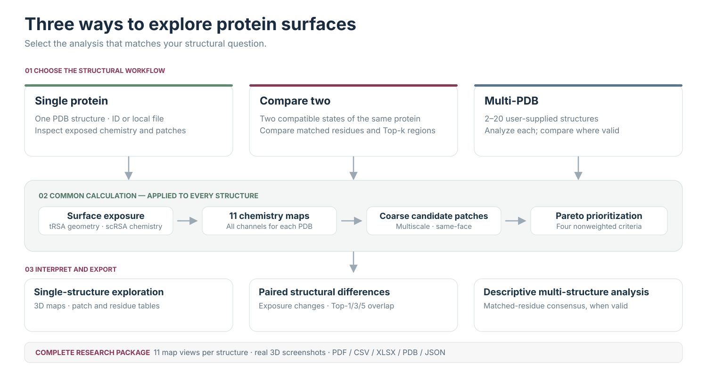
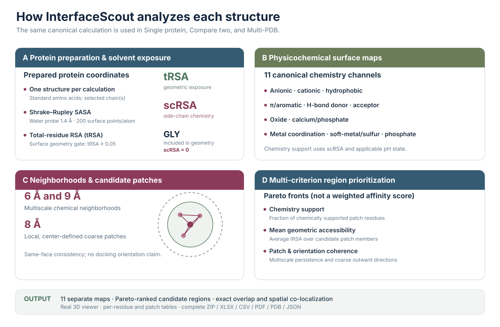

<div align="center">


# InterfaceScout

**Physicochemical protein-surface mapping for research-driven candidate-region analysis**

[](https://github.com/zeynepguneryilmaz/InterfaceScout/actions/workflows/publication-ci.yml)
[](LICENSE)
[](#installation)
[](CITATION.cff)

*Explore accessible surface chemistry. Compare structures. Prioritize regions for experimental or computational follow-up.*

</div>

---

## Overview

**InterfaceScout** is a locally run, open-source tool for characterizing the accessible physicochemical landscape of protein structures. From a PDB structure, it calculates **11 complementary surface-chemistry maps**, displays candidate regions in an interactive 3D viewer, and exports traceable residue- and patch-level results.

It is designed for researchers investigating **protein–material interfaces**, surface accessibility, biomolecular interactions, and conformational differences. It helps formulate testable hypotheses and choose regions for subsequent experiments or higher-resolution simulations.

> **Scientific scope:** InterfaceScout identifies and compares *protein-side physicochemical candidate regions*. It does **not** predict experimentally observed adsorption sites, binding orientations, adsorption free energies, kinetics, or adsorption-induced conformational change.

### Accessibility model (v1.1.0)

InterfaceScout now separates **geometric exposure** from **chemical side-chain accessibility**:

- **tRSA** (total-residue relative SASA) is total-residue heavy-atom SASA divided by the residue-specific theoretical maximum of Tien *et al.* (2013). The fixed geometric surface gate is tRSA >= 0.05.
- **scRSA** (side-chain relative SASA) describes exposure of non-backbone heavy atoms and determines chemical support, not surface membership.
- **Glycine** is represented in geometrical neighborhoods using its total-residue tRSA, with zero side-chain SASA/scRSA. Its Cα atom is no longer treated as an artificial chemical side chain.
- The 11 maps, patch radii of 6/9 Å and 8 Å coarse-patch scale remain, but patch mean geometric accessibility and Pareto prioritization now use **tRSA** instead of scRSA.

**Version compatibility:** v1.1.0 maps and rankings are not numerically interchangeable with v1.0.0 results. Recalculate earlier structures before comparing them under one method. The 0.05 total-RSA cutoff is a documented, sensitivity-tested modeling convention, **not** a demonstrated optimal adsorption-site threshold. Earlier paired legacy/dual experimental studies predate the final patch-ranking tRSA integration and must not be presented as final-v1.1.0 validation.

**Method reference:** Tien MZ *et al.* (2013), *Maximum Allowed Solvent Accessibilities of Residues in Proteins*, PLOS ONE 8:e80635, [doi:10.1371/journal.pone.0080635](https://doi.org/10.1371/journal.pone.0080635). Technical rationale: [Dual-accessibility method](validation/DUAL_ACCESSIBILITY_LITERATURE_AND_METHOD.md).

## How it works

InterfaceScout supports **three distinct workflows**, not just single-PDB input. Each supplied structure is processed independently through the same 11 chemistry maps; only biologically corresponding residues are eligible for matched-position comparison or descriptive consensus.



The underlying method separates **whole-residue tRSA for geometric exposure** from **side-chain scRSA for chemical support**, retains glycine in geometry without fictitious side-chain chemistry, and prioritizes spatially coherent regions using multiple Pareto criteria.



**Interface modes:** **Single protein** analyzes one PDB; **Compare two** compares two compatible structures of the *same protein*; **Multi-PDB** analyzes **2–20** supplied structures, each with all 11 maps. The last two modes do not parse MD trajectories or infer conformational populations. For actual UI screenshots (rather than illustrations), see the [real-browser screenshot workflow](.github/workflows/capture-real-readme-ui.yml); screenshots must be captured from running software and are never fabricated.

## What you can do

| Workflow | Purpose |
| --- | --- |
| **Explore a protein** | Inspect all 11 chemistry maps, the surface-accessible residues, and ranked candidate patches |
| **Combine maps** | Compare exact residue intersections **separately** from spatial co-localization within an 8 Å patch; inspect the three Regional Chemistry Profile descriptors for each candidate region |
| **Use Quick Views** | Open curated, descriptive map combinations without configuring individual channel weights |
| **Compare two structures** | Examine changes in accessibility and Top-1/3/5 patch-membership sets across compatible PDB structures |
| **Analyze multiple PDBs** | Analyze each structure independently, with matched-residue comparisons and descriptive consensus where valid |
| **Export complete evidence** | Save all 11 maps per structure, navigable PDFs, real 3D screenshots, tabular data, annotated PDBs, and machine-readable JSON |

### Regional Chemistry Profile (only when two or more maps are selected)

The optional **Regional Chemistry Profile** provides *three separate, transparent descriptors* for every existing combined-map candidate patch. It reuses the original protein structure and canonical 11-map chemistry values; **it does not create a combined affinity score or alter Pareto rankings**.

| Descriptor | Calculation | What to read |
| --- | --- | --- |
| **Per-channel mean local support**, 0–1 | Mean of the original `local_score` over all patch member residues; absent channel support contributes zero | How strongly each selected chemistry is locally represented, relative to this model's support rule |
| **Supporting residue count and fraction** | Number of members with original `local_score > 0`, divided by patch member count | Whether the feature is represented by one/few residues or distributed among many |
| **Minimum distinct-residue Cα separation**, Å | Minimum geometric Cα distance between **different** residues supporting different selected maps | Are the chemical features physically near each other rather than merely located in the same center-defined 8 Å patch? |

A displayed value of **NA** means no distinct supporting residue pair or missing coordinates; it must not be treated as zero. For three or more selected channels the detailed output reports the nearest distance **for each map pair**. Cα distance is a coarse spatial descriptor, not an atomic bond length, actual contact, or adsorption energy. Channels can represent correlated chemistry and must not be interpreted as independent experimental evidence.

These three descriptors were retained after a label-free audit of **48 proteins × eight predefined map combinations = 384 protein–map comparisons**, covering 17,353 candidate-region records. [Protocol, descriptive information analysis and decision record](validation/REGIONAL_CHEMISTRY_EVIDENCE_AND_METHOD.md). The audit establishes nonidentical local support, coverage and distance information; it **does not demonstrate material-specific adsorption-site prediction**. A proposed regional-contrast readout and a weakest-channel combined scalar were excluded because they add no defensible independently interpretable information.

The *Combined Maps* panel displays the values beside each existing patch and includes an expandable method explanation. The original **Download complete Excel** and separate **research JSON** button recalculate and include all selected-map regions; the **Complete ZIP** embeds readable `Regional_Channels`, `Regional_Pair_Distances`, and `Regional_Method` tables in CSV/XLSX plus the complete `combined_maps.json` and a summary in `Complete_Surface_Atlas.pdf`. For individual map-only analyses these combined-map tables do not apply.

### The 11 surface maps

| # | Map | Protein-side feature examined |
| --- | --- | --- |
| 01 | Anionic surface | Compatibility with negatively charged surface chemistry |
| 02 | Cationic surface | Compatibility with positively charged surface chemistry |
| 03 | Hydrophobic | Nonpolar exposed regions |
| 04 | π / aromatic | Aromatic surface features |
| 05 | H-bond donor | Potential hydrogen-bond donor features |
| 06 | H-bond acceptor | Potential hydrogen-bond acceptor features |
| 07 | Metal-oxide | Chemistry rules associated with metal-oxide interfaces |
| 08 | Calcium/phosphate charged-site | Charged-site chemistry relevant to calcium/phosphate contexts |
| 09 | Transition-metal coordination | Candidate coordinating-residue environments |
| 10 | Soft-metal sulfur-affinity | Sulfur-associated surface features |
| 11 | Phosphate-rich surface | Chemistry rules associated with phosphate-rich interfaces |

These are **chemistry-informed descriptors**, not measured affinities or calibrated material-specific adsorption probabilities. Every run calculates all 11 maps; choosing a view never removes channels from the complete export.

## User guide

For a complete, step-by-step walkthrough of installation, the three analysis workflows, all 11 maps, Regional Chemistry Profile, conformational comparisons, full exports, and scientifically responsible interpretation, see the **[InterfaceScout User Guide (English)](docs/USER_GUIDE.md)**.

## Get started

### Requirements

- **Windows, macOS, or Linux**
- **Python 3.10, 3.11, or 3.12**
- A modern browser with WebGL support for 3D visualization
- Internet access for the initial dependency installation and optional PDB-ID retrieval; **local PDB files can be analyzed offline after installation**

### Installation

Download a repository ZIP using **Code → Download ZIP**, extract it completely, and launch from the extracted InterfaceScout folder. When verified release packages become available, they will appear under [Releases](https://github.com/zeynepguneryilmaz/InterfaceScout/releases).

| Operating system | First launch | Later launches | Guide |
| --- | --- | --- | --- |
| Windows | Double-click `run_local.bat` | `start.bat` | [Windows](docs/INSTALL_WINDOWS.md) |
| macOS | `bash run_local.sh` | `bash start.command` | [macOS](docs/INSTALL_MACOS.md) |
| Linux | `bash run_local.sh` | `bash start.sh` | [Linux](docs/INSTALL_LINUX.md) |

Open **http://localhost:8000** if the browser does not open automatically. These are Python-backed local launchers, **not** stand-alone executables. Optional branded desktop shortcuts are documented in the platform guides.

**Windows note:** A future Windows release bundle may include local dependency wheels for supported Python versions; a repository source ZIP does not contain that wheelhouse. See the [Windows installation guide](docs/INSTALL_WINDOWS.md) for secure setup and certificate troubleshooting.

### First analysis

1. Enter a **PDB ID** or upload a **local PDB file**; choose a chain if required.
2. Set **pH** if relevant, then click **Analyze**.
3. Browse individual chemistry maps or select a Quick View; rotate the 3D structure and inspect ranked patches.
4. Optionally combine channels to distinguish **shared residues** from **nearby but distinct residues**, and inspect *Regional Chemistry Profile* support, supporting-residue fraction and Cα separation without changing any map ranking.
5. Select **Download complete results · ZIP** to obtain the complete 11-map evidence package.

For comparison workflows, supply another PDB representing the **same protein** with compatible residue identifiers, or add structures through **Multi-PDB**. No trajectory parsing or hidden automatic structure alignment is performed.

## Results and interpretation

The complete ZIP includes, for **each analyzed structure**, all 11 map PDFs, original structure data, 3D map screenshots captured from the browser viewer, an Excel workbook, per-residue and per-patch CSVs, annotated B-factor PDBs, and detailed JSON. For selected multi-map views it also includes complete, numerical Regional Chemistry Profile CSV/XLSX tables and selected-region provenance. Where applicable, multi-structure exports add matched-residue comparisons and consensus. A **Complete Surface Atlas** PDF provides navigable chemistry-map pages, a linked contents section, and provenance information. The optional publication PNG tool renders the selected real 3D view at 1920 × 1080 pixels.

| Readout | Appropriate interpretation |
| --- | --- |
| Ranked patch colors | Categorical *patch rank*, **not** a continuous affinity heatmap |
| Per-residue scores | Calculated model descriptors; inspect numerical values in CSV/XLSX |
| Overlap | Exact shared residue membership across selected maps |
| Co-localization | Multiple channel features occur within the **same center-defined 8 Å candidate patch**; contributing residues need not be within 8 Å of one another |
| Regional Chemistry Profile | Per-channel local support, supporting-residue count/fraction and **actual distinct-residue Cα separation**; not a combined binding score |
| Multi-PDB consensus frequency | Fraction of the **supplied structures** with membership; not an equilibrium population or adsorption probability |
| B-factor PDB values | InterfaceScout display values written to the B-factor field; **not crystallographic temperature factors** |

Comparisons require the same **chain ID, residue number, insertion code, and residue identity** for matched positions. Unmatched proteins must not be interpreted as conformational comparisons.

### Inputs and model settings

| Parameter | Current treatment |
| --- | --- |
| Structure | PDB ID or uploaded PDB |
| Chain | Optional selection |
| pH | Used in the current scoring model |
| Ionic strength and temperature | Stored as run metadata; **not** explicitly modeled as screening or temperature effects |
| Shrake–Rupley probe radius | 1.40 Å |
| Sampling | 200 points per atom |
| Side-chain exposure threshold | scRSA ≥ 0.05 |
| Multiscale neighborhood radii | 6 and 9 Å |
| Coarse patch scale | 8 Å |

The sampling level and neighborhood radii were selected by **label-free numerical/consensus analysis**, not by fitting experimental adsorption contacts. The patch scale was predefined geometrically. Parameter provenance and tests are documented in [validation](validation/README.md) and [parameter_selection.json](validation/parameter_selection.json); the computational model version is tracked separately from the public software release version.

### Limitations

InterfaceScout is best interpreted as **structural characterization and hypothesis generation**, especially for folded proteins represented by suitable atomic structures. Use particular caution for intrinsically disordered proteins, adsorptive unfolding, membrane-embedded proteins, missing glycans/cofactors, nonstandard residues, and chemistry driven by species discarded during structure preparation.

It does **not** simulate dynamics, compute adsorption pose or free energy, measure protein corona formation, or assign experimentally confirmed binding sites. For a collection of simulation conformers, export representative PDB frames before comparison; native XTC, TRR, and DCD trajectory ingestion is not available. Prior benchmarking does not establish general adsorption predictive accuracy. Regional Chemistry Profile is descriptive; co-localized channels may be chemically correlated, and the method does not model explicit atomistic contacts, nanoparticle curvature or adsorption-induced structural changes.

## Reproducibility and development

Run the test suite from the repository root after installing the backend requirements:

```bash
python -m pip install -r backend/requirements.txt
python -m unittest discover -s tests -v
python validation/verify_publication.py
```

[Cross-platform CI](https://github.com/zeynepguneryilmaz/InterfaceScout/actions/workflows/publication-ci.yml) tests supported Python versions across Windows, macOS, and Linux. A failing or pending CI run is **not** a verified release. Large-structure and browser checks are separate from the core unit tests. The compact [examples index](examples/README.md) documents available workflows; some historical generated example results are preserved in the private development archive rather than bundled in this public source repository.

## Citation, licensing and acknowledgments

If InterfaceScout supports your research, please **cite the software** using [CITATION.cff](CITATION.cff). Cite a related peer-reviewed publication when one is available; no unpublished article is presented as an existing citation.

**InterfaceScout's original code and documentation are licensed under the [MIT License](LICENSE)**, copyright © 2026 Ö. Zeynep Güner Yılmaz. MIT allows reuse and modification, including commercial reuse, subject to its notice conditions. Embedded third-party libraries retain **their own licenses**; see [Third-party notices](THIRD_PARTY_NOTICES.md).

3D molecular visualization uses [3Dmol.js](https://github.com/3dmol/3Dmol.js); browser spreadsheet handling uses [SheetJS Community Edition](https://docs.sheetjs.com/). These dependencies do not imply endorsement of InterfaceScout by their authors.

For problems or reproducible bug reports, open a [GitHub issue](https://github.com/zeynepguneryilmaz/InterfaceScout/issues) and include the operating system, Python version, PDB identifier (or a safely shareable minimal input), and steps to reproduce. Avoid uploading confidential structures or unpublished data to public issues.
