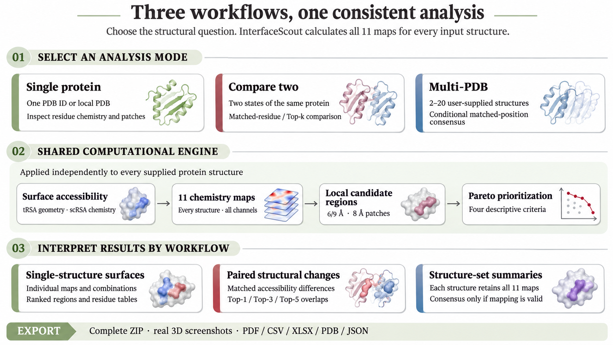
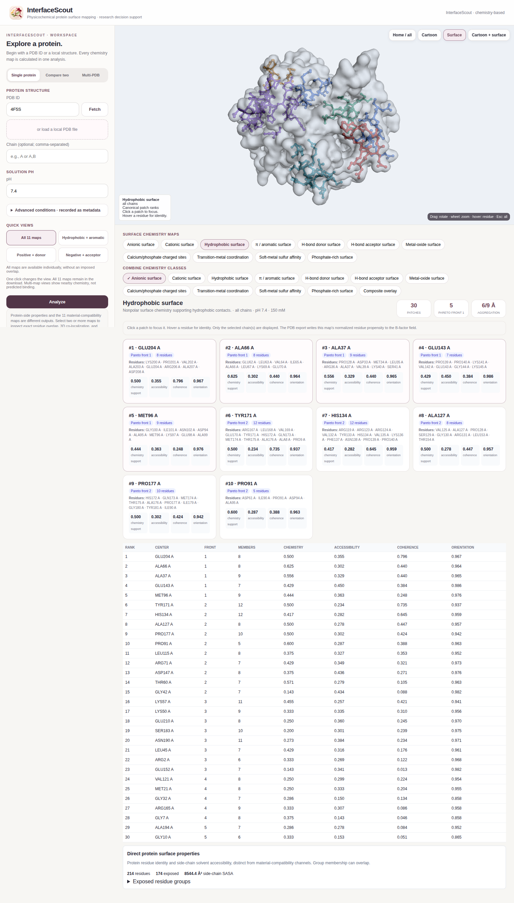
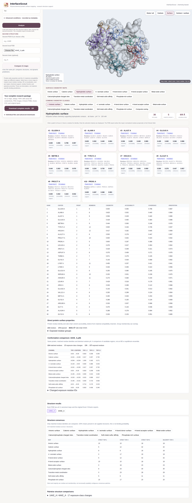
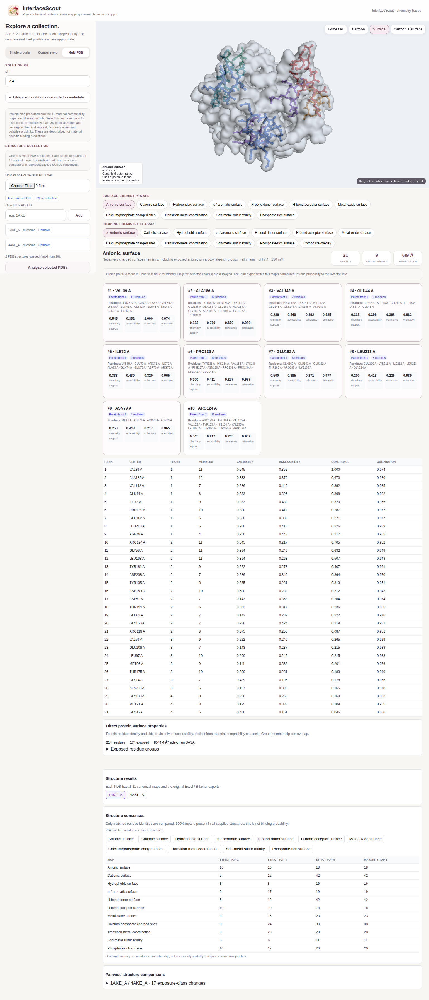
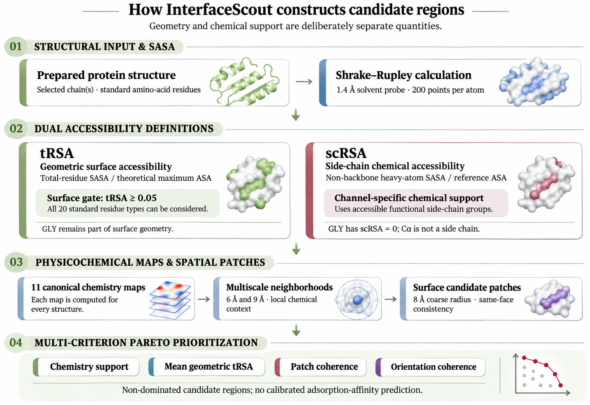

<div align="center">


# InterfaceScout

**Physicochemical protein-surface mapping and candidate-region analysis**

[](https://github.com/zeynepguneryilmaz/InterfaceScout/actions/workflows/publication-ci.yml)
[](LICENSE)
[](#requirements)
[](https://github.com/zeynepguneryilmaz/InterfaceScout/releases/tag/v1.1.0-npbe-platform-20261125)

*Explore protein-surface chemistry, compare structural states, and prioritize candidate regions for further experimental or computational investigation.*

</div>

## Download

**[InterfaceScout v1.1.0](https://github.com/zeynepguneryilmaz/InterfaceScout/releases/tag/v1.1.0-npbe-platform-20261125)** is the publication release (model 2.5.0-dual-accessibility), with separate Windows, macOS Intel and Linux ZIPs, SHA-256 checksums and build manifests. The packages are built from [source commit 636bc5a](https://github.com/zeynepguneryilmaz/InterfaceScout/tree/636bc5abfd72798965465ccb7bf79deb0ed2f951). Python 3.10–3.12 is required; optional electrostatics requires separately installed external tools. See the [installation guides](docs/USER_GUIDE.md#2-installation-and-requirements) and [research datasets](datasets/README.md).

## Overview

**InterfaceScout** is an open-source, locally operated research tool for characterizing physicochemical features on protein surfaces. It analyzes PDB structures using **11 complementary chemistry maps**, identifies spatially coherent candidate regions, and provides interactive three-dimensional visualization and reproducible numerical exports.

The software is intended for preliminary structural investigation of protein–material interfaces and related biomolecular systems. Its maps describe the **protein side of an interface** and help researchers formulate hypotheses, compare structural representations, and select regions for subsequent experiments or detailed simulations.

## Analysis workflows

InterfaceScout supports three analysis modes. The same 11-map computation is applied to each supplied structure, while the comparison functions depend on valid residue correspondence.



| Mode | Input | Main results |
| --- | --- | --- |
| **Single protein** | One PDB ID or locally supplied PDB file; optional chain selection | Eleven chemistry maps, solvent-accessibility profiles, ranked candidate patches, and combined-map analysis |
| **Compare two** | Two compatible structures of the **same protein** | Matched-residue changes in surface accessibility and Top-1, Top-3, and Top-5 patch-membership comparisons |
| **Multi-PDB** | **2–20** user-supplied structures | Eleven maps per structure, structure-level results, and descriptive comparisons or residue consensus where correspondence is valid |

Comparison is based on compatible residue identifiers and identities. The application does not automatically align unrelated sequences, superpose structures, or parse native molecular-dynamics trajectory files. Consensus frequencies describe the **supplied structures**, not equilibrium populations.

### Application interface

The interface combines protein visualization, map selection, residue-level inspection, and ranked candidate-region tables.



<details>
<summary>Additional interface views: structure comparison and Multi-PDB analysis</summary>

**Compare two**



**Multi-PDB**



</details>

## Computational method

InterfaceScout distinguishes **geometric surface accessibility** from **accessible side-chain chemistry**. This distinction is used consistently for the 11 maps and the downstream construction and prioritization of candidate regions.



### Surface accessibility

A Shrake–Rupley calculation with a **1.4 Å probe** and **200 points per atom** provides atom-level solvent-accessible surface areas (SASA). Two complementary residue descriptors are then derived:

- **tRSA (total-residue relative solvent accessibility):** the SASA of all heavy atoms in a residue divided by its residue-specific theoretical maximum. Surface membership uses **tRSA ≥ 0.05**. The reference values follow [Tien et al. (2013)](https://doi.org/10.1371/journal.pone.0080635).
- **scRSA (side-chain relative solvent accessibility):** solvent exposure of non-backbone heavy atoms, normalized by the model's side-chain reference areas. This descriptor contributes to chemistry-specific scoring.

**Glycine** participates in geometric surface and neighborhood calculations through tRSA. Because it has no non-backbone heavy-atom side chain, its scRSA and side-chain chemical contribution are zero.

The **0.05 tRSA threshold** is a fixed, sensitivity-tested modeling convention. Patch mean accessibility and associated prioritization use tRSA rather than scRSA.

### Physicochemical maps

Every analysis computes all 11 maps; map selection in the viewer does not change the underlying set of calculated channels.

| Map | Protein-side feature or compatibility rule |
| --- | --- |
| Anionic surface | Exposed groups relevant to negatively charged interface chemistry |
| Cationic surface | Exposed groups relevant to positively charged interface chemistry |
| Hydrophobic | Accessible nonpolar features |
| π / aromatic | Accessible aromatic and π-associated features |
| H-bond donor | Side-chain features relevant to hydrogen-bond donation |
| H-bond acceptor | Side-chain features relevant to hydrogen-bond acceptance |
| Metal-oxide | Chemistry rules associated with oxide-like interfaces |
| Calcium/phosphate charged sites | Complementary interactions relevant to calcium- or phosphate-rich sites |
| Transition-metal coordination | Accessible side-chain environments potentially relevant to coordination |
| Soft-metal sulfur affinity | Sulfur-associated compatibility with soft-metal-like interfaces |
| Phosphate-rich surface | Chemistry rules associated with phosphate-rich interfaces |

The channels represent complementary, potentially correlated protein-side chemistry.

### Candidate-region construction

Chemical support is aggregated in **6 Å and 9 Å** neighborhoods. Local, center-defined **8 Å** candidate patches capture coarse spatial organization while considering surface-facing geometric consistency.

Patches are characterized by chemistry support, mean geometric accessibility (tRSA), patch coherence, and orientation coherence. **Multi-criterion Pareto prioritization** provides a descriptive ordering of candidate regions.

## Exploring and combining maps

Individual maps can be examined in **Cartoon**, **Surface**, or **Cartoon + surface** representations. Users can rotate the structure, inspect residues, focus on candidate patches, and review the corresponding residue and patch tables.

**Quick Views** provide predefined descriptive selections: *All 11 maps*, *Hydrophobic + aromatic*, *Positive + donor*, and *Negative + acceptor*. Alternatively, users can select individual channels or combine two or more maps.

Multi-map analysis distinguishes:

- **Exact residue overlap:** the same residue belongs to multiple selected chemistry maps.
- **Spatial co-localization:** features associated with different selected channels occur within the same center-defined candidate patch; they need not belong to the same residue.

For combined selections, the **Regional Chemistry Profile** reports three separate descriptors for each candidate region: per-channel mean local support, count and fraction of supporting residues, and minimum Cα separation between distinct residues supporting different channels. More detailed pairwise distance tables are available for selections of multiple channels.

The Regional Chemistry Profile preserves the ranking of the underlying canonical patches. An undefined distance indicates no eligible residue pair or unavailable coordinates, not a zero-distance contact.

The descriptors were assessed in a label-free methodological audit covering **48 proteins and eight prespecified map combinations**; see [methodology and evidence](validation/REGIONAL_CHEMISTRY_EVIDENCE_AND_METHOD.md). 

### Optional continuum electrostatics

The **Electrostatics** checkbox in the single-structure interface (or `"electrostatics": true` in the `/analyze`, `/compare`, or `/structure-set` request) runs **PDB2PQR with PROPKA titration-state assignment** followed by **APBS nonlinear Poisson–Boltzmann (NPBE)** by default on the same prepared protein. The server must have the `pdb2pqr` and `apbs` executables on its PATH; check `GET /health`. PDB2PQR must include PROPKA support. The external applications are installed separately. Advanced solver modes are `npbe`, `lpbe` and `both` (NPBE primary with LPBE comparison).

**Numerical verification:** paired LPBE/NPBE calculations, grid sensitivity, real-solver regression and performance records are available in the [research datasets](datasets/README.md). Diagnostic flags identify numerical warnings, sampling coverage and grid limitations.

The optional electrostatics response now includes **primary, area-weighted `surface_potential_kT_per_e` values** from a deterministic approximate solvent-accessible probe-center shell (1.4 Å probe, +0.25 Å outward displacement, 42 Fibonacci directions per PQR heavy atom), with `surface_sampling_area_A2` and `surface_potential_samples`. An exposed glycine can have a surface potential even though it has no heavy side chain. The older `sidechain_mean_potential_kT_per_e` field remains a **separate atom-coordinate comparator**, not the primary surface result. Neither is a material adsorption energy or a fitted affinity. Surface sampling depends on SciPy (pinned in backend requirements). The method approximates SAS, not an analytic SES, and APBS grid refinement on capped grids requires explicit caution. ZIP/Excel/CSV include both fields and provenance.

The response also includes matched-residue PQR net atomic charges (e); glycine's side-chain potential is null. Ion concentration is specified as symmetric monovalent electrolyte (`ionic_mM/1000` mol/L); temperature enters APBS, unlike the canonical scoring model. APBS calculation uses a default dielectric model (solute 2, solvent 78.54); these are assumptions, not fitted adsorption parameters.

**Scientific separation:** the eleven canonical chemistry channels, SASA, patch membership and Pareto ranks are independent of the optional PB annotation. Electrostatic calculation failures are reported explicitly; canonical maps remain available. In paired mode, the primary and secondary solver outputs retain their identities and numerical diagnostics.

For a local environment, install compatible PDB2PQR (with PROPKA) and APBS distributions, ensure both commands run on PATH, then select the checkbox and analyze a full-atom protein. The external solver is only invoked when explicitly requested. Benchmark computation costs and verify force-field completeness and appropriate solvent conditions for your structure before scientific interpretation.

## Results and exports

**Download complete results · ZIP** provides the principal reproducible output. Where applicable, each analyzed structure is accompanied by:

| Output | Contents |
| --- | --- |
| **3D visualizations** | Viewer-derived screenshots for all 11 maps; optional selected-map publication PNG |
| **PDF reports** | Individual map reports and a navigable **Complete Surface Atlas** |
| **Excel and CSV** | Residue profiles, map values, candidate-patch descriptors, and applicable combined-map tables |
| **JSON** | Numerical analysis results, settings, method information, and provenance |
| **PDB files** | Original structure information and annotated B-factor PDB visualizations |
| **Multi-structure results** | Matched-residue comparisons and descriptive consensus where supported |

An optional **1920 × 1080** publication PNG can be generated from the 3D viewer through the advanced download controls. B-factor PDB values are InterfaceScout visualization descriptors stored in the B-factor column; they must **not** be interpreted as experimentally measured crystallographic temperature factors.

## Installation and first analysis

### Requirements

- Windows, macOS, or Linux
- Python **3.10–3.12**
- A modern browser with WebGL support
- Internet connection for initial dependency installation and optional retrieval of PDB IDs; local PDB files can be processed offline once dependencies are installed

### Installation

Download the appropriate platform ZIP from the [publication release](https://github.com/zeynepguneryilmaz/InterfaceScout/releases/tag/v1.1.0-npbe-platform-20261125), extract it, and launch InterfaceScout from the extracted directory. Developers may instead clone the source repository.

| Operating system | Initial launch | Subsequent launch |
| --- | --- | --- |
| Windows | `run_local.bat` | `start.bat` |
| macOS | `bash run_local.sh` | `bash start.command` |
| Linux | `bash run_local.sh` | `bash start.sh` |

Open [http://localhost:8000](http://localhost:8000) if the browser does not open automatically. InterfaceScout uses a local Python backend and browser interface; the source distribution is **not a standalone compiled executable**.

Platform-specific setup: [Windows](docs/INSTALL_WINDOWS.md) · [macOS](docs/INSTALL_MACOS.md) · [Linux](docs/INSTALL_LINUX.md).

### Quick start

1. Select **Single protein** and fetch a PDB ID or load a local `.pdb` file.
2. Confirm the structure and choose a chain or multiple chains when appropriate.
3. Set the **pH** (default **7.4**) and select **Analyze**. All 11 maps are computed.
4. Explore individual maps, Quick Views, ranked patches, and optional multi-map combinations.
5. Save **Download complete results · ZIP** for reproducible downstream analysis.

**Model conditions:** pH affects the current chemical scoring rules. Ionic strength and temperature are metadata for the canonical chemistry maps and physical inputs to optional continuum electrostatics.

For detailed instructions, interpretation guidance, and example workflows, see the **[InterfaceScout User Guide](docs/USER_GUIDE.md)**.

## Scientific interpretation and limitations

InterfaceScout provides **protein-side structural descriptors and candidate-region prioritization**, not experimentally validated adsorption-site predictions. The suitability of a result depends strongly on the structure supplied, including its biological assembly, chain selection, construct identity, structural state, and unresolved or modified residues.

Care is required when analyzing intrinsically disordered systems, membrane proteins, conformationally heterogeneous proteins, structures missing important glycans or cofactors, or systems in which adsorption changes protein conformation. The current model does not explicitly represent substrate curvature, atomic-scale material chemistry, native MD trajectories, adsorption-induced unfolding, or adsorption free energies.

Surface maps and ranks are model-derived quantities. Closely related channels may be correlated, and multiple agreeing maps must not be treated as independent experimental confirmation. Report matched-residue assumptions when comparing structures, and avoid interpreting a supplied structure-set consensus as a kinetic or thermodynamic population.

The fixed model settings and numerical provenance are documented in the [validation index](validation/README.md).

## Active validation datasets

The publication study uses two principal structural panels:

| Dataset | Purpose | Status |
| --- | --- | --- |
| **TV48 — Technical verification** | A frozen, quality-screened panel of **48 protein structures** for reproducibility, dual-accessibility implementation, 11-map consistency, patch construction, and numerical robustness | Completed for the tested production version |
| **ISV76 — Application panel** | **76 protein structures** for physicochemical mapping and structural applicability and surface-chemistry analysis, including biofilm-related proteins | 836 canonical maps; 64,592 candidate regions |

Download the [TV48 and ISV76 research packages](datasets/README.md), including the exact structure manifests, numerical outputs, external comparisons, sensitivity analyses and source-run checksums. The [publication evidence index](validation/PUBLICATION_EVIDENCE.md) identifies the original calculations. Earlier screening and exploratory analyses are retained as historical provenance.

## Testing and reproducibility

From a full repository checkout (rather than a platform distribution), install dependencies and run:

```bash
python -m pip install -r backend/requirements.txt
python -m unittest discover -s tests -v
python validation/verify_publication.py
```

The frozen historical parameter and benchmark check is separate from the archived publication data. The [cross-platform test workflow](https://github.com/zeynepguneryilmaz/InterfaceScout/actions/workflows/publication-ci.yml) covers supported Python environments. Browser-based rendering, export checks, and additional validation scripts are documented in the repository. The [publication release builds](https://github.com/zeynepguneryilmaz/InterfaceScout/actions/runs/45664039001) passed platform-specific packaging and integrity checks.

See the [examples index](examples/README.md) for example inputs and the user guide for reporting recommendations.

## Citation and license

If you use InterfaceScout in research, cite the software using [CITATION.cff](CITATION.cff). Any relevant experimental evidence or independent software used in a study should be cited separately.

InterfaceScout's original software and documentation are distributed under the **[MIT License](LICENSE)**, copyright © 2026 Ö. Zeynep Güner Yılmaz. Third-party components retain their respective licenses; see [Third-party notices](THIRD_PARTY_NOTICES.md).

The interface uses [3Dmol.js](https://github.com/3dmol/3Dmol.js) for molecular visualization and [SheetJS Community Edition](https://docs.sheetjs.com/) for browser-side spreadsheets.

## Support

For reproducible bugs or usage problems, open a [GitHub issue](https://github.com/zeynepguneryilmaz/InterfaceScout/issues) with the operating system, Python version, relevant structure identifier, and steps to reproduce. Do not submit confidential or unpublished structural data in public issues.
